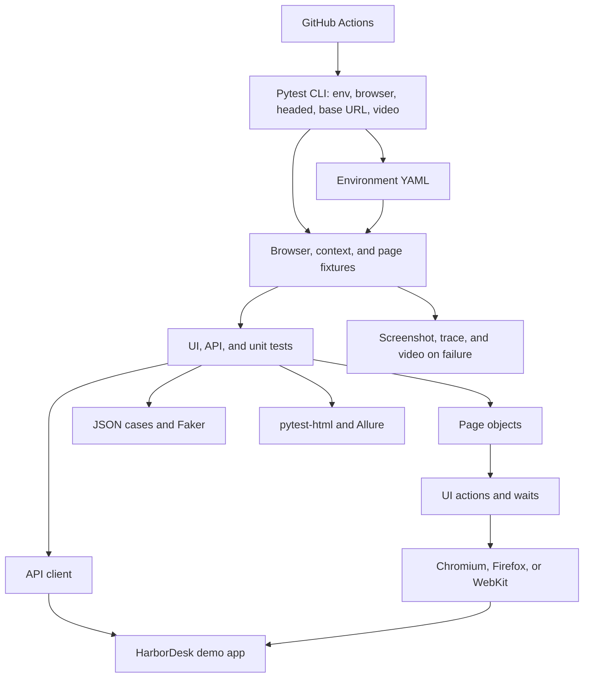

# Enterprise Web UI Automation Framework

Reusable browser automation framework for senior QA work. Pytest drives Playwright through page objects, shared fixtures, and a small JSON API used to arrange data. The system under test is HarborDesk, a local work-tracking application, so a run does not depend on a third-party website.

Accounts, tasks, and passwords in this repository are synthetic fixtures.

## Architecture



The source diagram is `docs/architecture.mmd`.

Dependency direction:

- Tests call page objects and the API client.
- Page objects call UI actions.
- UI actions talk to Playwright.
- The framework does not import FastAPI route handlers.
- The demo application does not import the test framework.
- Pytest starts HarborDesk in a child process unless `--base-url` points at an already running app.

## Technology stack

| Piece | Role |
| --- | --- |
| Python 3.13 | Framework, tests, and demo app |
| Playwright for Python 1.65 | Chromium, Firefox, and WebKit |
| Pytest 9 | Runner, markers, and fixtures |
| pytest-xdist 3.8 | Parallel workers |
| pytest-html 4.2 | Self-contained HTML report |
| pytest-rerunfailures 16.7 | Optional failure retries |
| Allure Pytest 2.16 | Allure result files |
| Faker | Unique users and work items |
| httpx | API setup and cleanup |
| FastAPI and Uvicorn | Local HarborDesk application |
| Ruff | Lint and format |
| pip-audit | Dependency vulnerability check |
| GitHub Actions | Pull request and push regression |

Versions are pinned in `requirements.txt`.

## Features

1. Page Object Model for login, registration, dashboard, items, profile, and admin.
2. Session-scoped browser fixture and function-scoped context and page fixtures.
3. Chromium, Firefox, and WebKit.
4. Cross-browser runs through `--browser`.
5. Headless by default, headed with `--headed`.
6. `local` and `staging` YAML profiles selected with `--env`.
7. Reusable click, fill, select, and navigation helpers.
8. Each interaction waits until the locator is visible, using timeouts from the profile.
9. Full-page screenshot on failure.
10. Video retained on failure when recording is enabled.
11. Playwright trace saved on failure and discarded after a pass.
12. Data-driven UI cases from `test_data/*.json`.
13. Faker-backed users and items that satisfy the password and field rules.
14. HTTP client for register, login, create, update, delete, and session expiry.
15. Parallel execution with pytest-xdist.
16. Retry count from the environment file, or `--reruns` on the command line.
17. File and console logging. Secret field values are written as `***`.
18. pytest-html and Allure result directories.
19. Markers: `smoke`, `regression`, `auth`, `crud`, `negative`, `api`, `unit`, `ui`, `evidence`.
20. CLI options `--env`, `--browser`, `--headed`, `--base-url`, and `--record-video`.

## Folder structure

```text
config/environments/     local.yaml and staging.yaml
demo_app/                HarborDesk FastAPI application
framework/               settings, logging, waits, API client, Faker factory
pages/                   page objects
tests/ui/                browser scenarios
tests/api/               JSON API checks
tests/unit/              pure Python checks
tests/meta/              intentional failure used to prove artifacts
tests/support/           demo process startup
test_data/               JSON cases
scripts/                 secret scan and failure-artifact check
.github/workflows/       pull request and push regression
docs/                    architecture, evidence, portfolio text
```

## Installation

```bash
python3 -m venv .venv
source .venv/bin/activate
python -m pip install -r requirements.txt
python -m playwright install chromium firefox webkit
```

On Linux CI, install the browser operating-system packages as well:

```bash
python -m playwright install --with-deps chromium
```

Windows uses `py -m venv .venv` and `.venv\Scripts\activate`.

## Configuration

`--env` selects `config/environments/<name>.yaml`. The default is `local`.

```yaml
timeout_ms: 10000
navigation_timeout_ms: 15000
headless: true
browser: chromium
retries: 0
record_video: false
tracing: true
base_url: null
```

`staging.yaml` uses a 12 second action timeout, a 20 second navigation timeout, and one retry. It is not a live host. The suite still starts HarborDesk on 127.0.0.1 unless you pass `--base-url`.

Override order is the YAML file, then environment variables (`BROWSER`, `HEADLESS`, `RECORD_VIDEO`, `TRACING`), then CLI options.

| Option | Effect |
| --- | --- |
| `--env local` | Profile name |
| `--browser chromium` | `chromium`, `firefox`, or `webkit` |
| `--headed` | Show the browser window |
| `--base-url http://127.0.0.1:8000` | Do not start a demo process |
| `--record-video` | Keep a video when the test fails |
| `--reruns 1` | Retry a failed test once |

Demo accounts match the seed data:

| Role | Email | Password |
| --- | --- | --- |
| Admin | `admin@demo.local` | `AdminPass123!` |
| Member | `member@demo.local` | `MemberPass123!` |
| Pager | `pager@demo.local` | `PagerPass123!` |

The pager account owns 12 stable items used for search and pagination. Tests must not edit or delete those items. These passwords are fixtures. The demo hash iterations are not a production password store.

`DEMO_ALLOW_TEST_HOOKS=true` exposes `POST /api/test/expire-session` and `POST /api/test/reset`. Pytest sets that variable for the child process. Leave it unset when running the app by hand.

## Execution commands

```bash
python -m pytest
python -m pytest -m smoke
python -m pytest -n auto --browser chromium
python -m pytest -n auto --browser firefox
python -m pytest -n auto --browser webkit
python -m pytest --headed --browser chromium -m smoke
python -m pytest --env staging
python -m pytest --reruns 1
```

The default command excludes the `evidence` marker. That test is expected to fail and exists only to prove artifact capture:

```bash
python scripts/capture_failure_evidence.py
```

Run the demo by itself:

```bash
DEMO_DB_PATH=.run/manual.sqlite python -m uvicorn demo_app.main:app --port 8000
```

Open `http://127.0.0.1:8000/login`.

## Cross-browser execution

`--browser` chooses the Playwright browser type. GitHub Actions runs the full suite once per browser in a matrix. Local verification for this repository ran the UI scenarios on Chromium, Firefox, and WebKit. See `docs/execution-evidence.md`.

## Parallel execution

```bash
python -m pytest -n auto --browser chromium
```

pytest-xdist starts one HarborDesk process in the controller and shares that URL with workers. Each worker launches its own browser. Tests that share the member or admin accounts only add uniquely named records, or they read the untouched pager data.

## Reporting

A normal run writes:

- `reports/pytest.html` — self-contained HTML report
- `reports/allure-results/` — Allure result files

Open the HTML file in a browser. Allure HTML needs the Allure command line:

```bash
allure generate reports/allure-results -o reports/allure-report --clean
allure open reports/allure-report
```

The Allure command is not installed by `requirements.txt`. CI uploads the raw result directory.

## Debugging

Failed tests keep:

- `artifacts/screenshots/<test>.png`
- `artifacts/traces/<test>.zip`
- `artifacts/videos/<test>/` when `--record-video` or `RECORD_VIDEO=1` is set

Open a trace with:

```bash
python -m playwright show-trace artifacts/traces/<file>.zip
```

Logs go to `logs/framework.log` and to the pytest output. Password fills are logged as `***`.

Use `--headed` and a longer timeout profile when you need to watch a flow:

```bash
python -m pytest tests/ui/test_authentication.py::test_admin_can_sign_in --headed --browser chromium
```

## CI/CD

`.github/workflows/ui-regression.yml` runs on pull requests and pushes.

1. Install pinned dependencies.
2. Run Ruff, the secret scan, and pip-audit.
3. Install Chromium, Firefox, and WebKit on separate jobs.
4. Run `pytest -n auto` for the full suite, including unit and API tests.
5. Upload the HTML report, Allure results, screenshots, traces, and the framework log.

Video recording stays off in CI (`RECORD_VIDEO=0`) so passing tests do not store a movie. Failure screenshots and traces are still collected.

## HarborDesk coverage

The demo app includes login, logout, registration, dashboard counts, profile edits, work-item create/update/delete, search, status and priority filters, pagination, server-side session expiry, and an admin-only user directory. Members only see their own items. Validation covers required fields, length limits, password rules, duplicate emails, and stored markup rendered as text.

## Quality checks

```bash
python -m ruff check .
python -m ruff format --check .
python scripts/secret_scan.py
python -m pip_audit -r requirements.txt
```

Recorded results are in `docs/execution-evidence.md`.

## License

MIT. See `LICENSE`.
